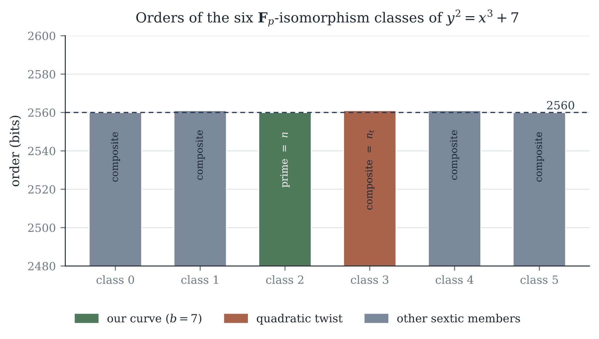
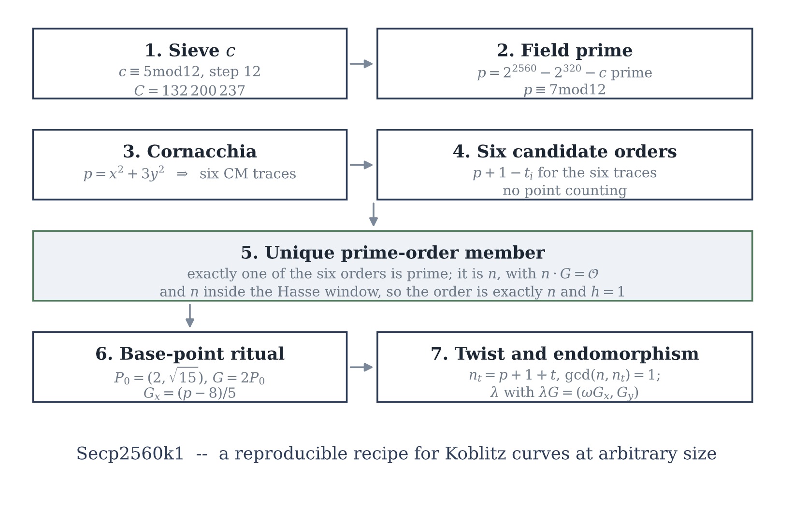
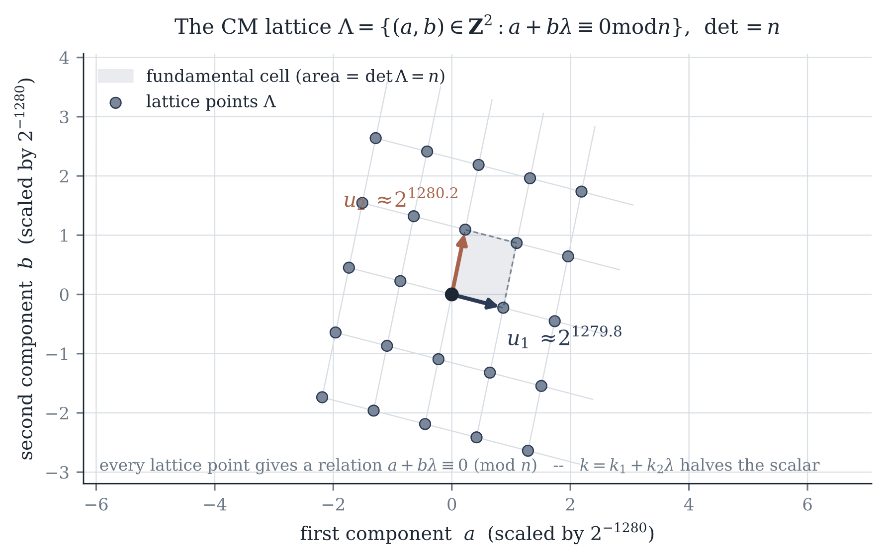
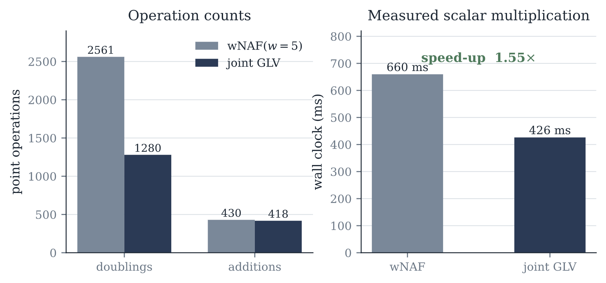
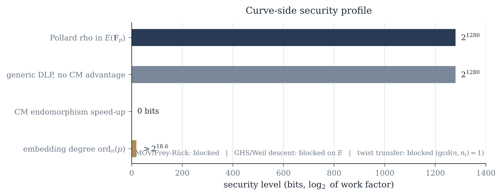
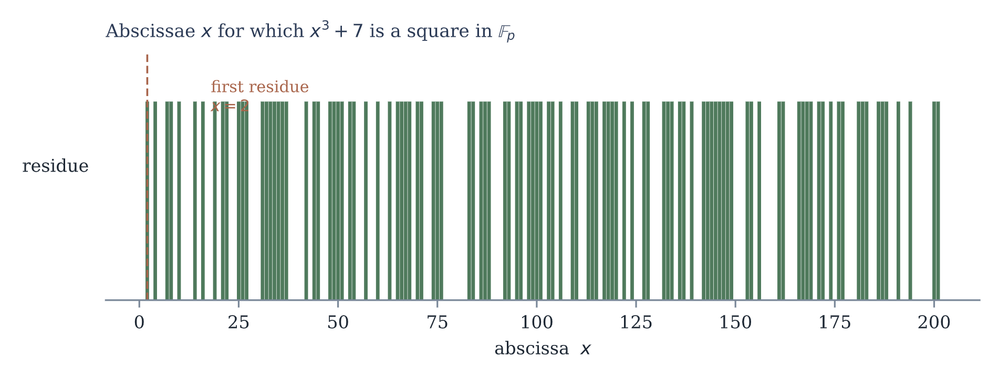
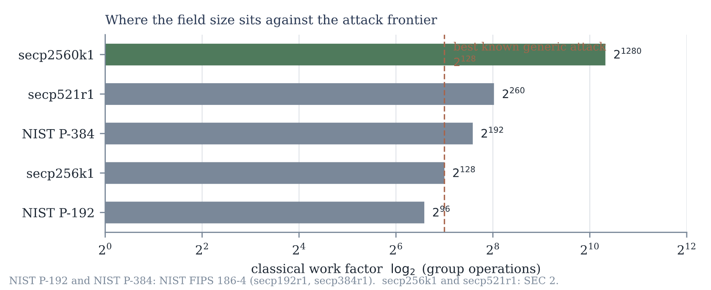
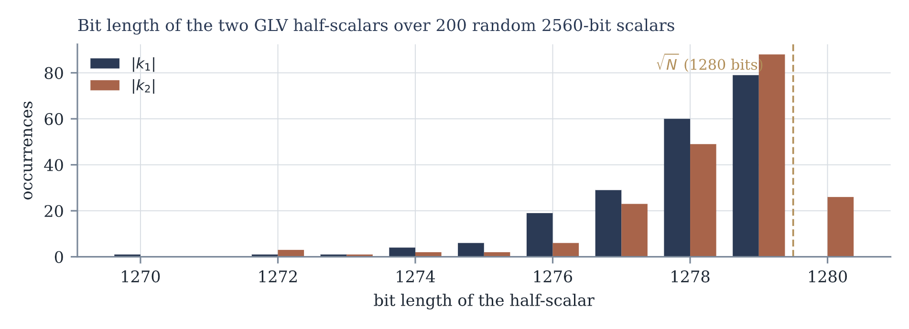
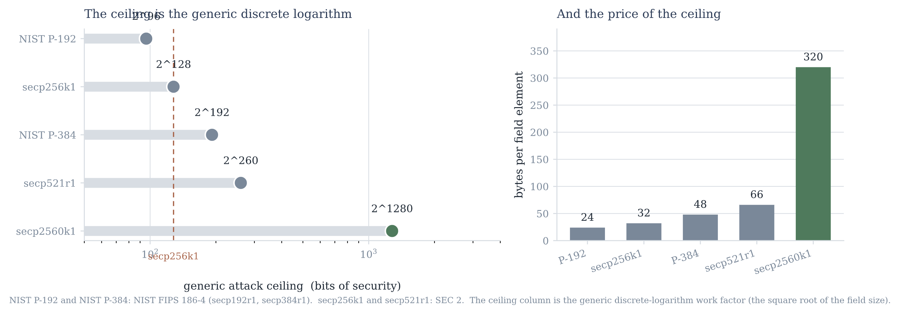

# secp2560k1 — a verifiable 2560-bit Koblitz-family curve generated by the SEC prescription

**An independent re-derivation and certification of the field, the order, the base point, the twist and the endomorphism of a 2560-bit Koblitz curve, together with a full-scale search over the parameter space of the prescription.**

Author: **Talal Alsrayea** (v2Talal) — independent researcher —
[ORCID 0009-0003-9644-9012](https://orcid.org/0009-0003-9644-9012)
Status: preprint / technical report. Date: October 2026. License: CC BY 4.0.

[](LICENSE)
[](paper/secp2560k1.pdf)
[](https://doi.org/10.5281/zenodo.23601899)

> **Scope.** This repository certifies a *curve*. It certifies no protocol, no signature
> scheme, no key-agreement protocol and no implementation. Everything stated here is a
> statement about one elliptic curve over one prime field.

---

## 1. The curve

| Quantity | Value |
|---|---|
| Field | `p = 2^2560 − 2^320 − 132200237` (prime, `c ≡ 5 mod 12`) |
| Curve | `y² = x³ + 7` over `F_p` |
| Order | `N = p + 1 − t`, `N` prime, 2560 bits |
| Trace | `t`, 1281 bits (Appendix A of the paper) |
| CM discriminant | `D = 4p − t²`, 2558 bits |
| Cofactor | `h = 1`, so `#E(F_p) = N` |
| Base point | `G = 2·P₀`, `P₀ = (2, √15)`, `x(G) ≡ (p−8)/5`, `y(G) ≡ 33/(5·y₀)` (odd) |
| Twist | `d = 2` → `b′ = 56`, `#E′ = p + 1 + t`, `v₃ = 1`, `gcd(N, n_t) = 1` |
| Endomorphism | `ω³ = 1`, `λ² + λ + 1 ≡ 0 (mod N)`, `det = +N`, `λ·G = (ω·x(G), y(G))` |
| Classical security | ≈ **1280 bits** (`min(log₂N/2, log₂p/2)`) |
| Margin over `secp256k1` | **1152 bits** of field size; over `secp521r1` **1020 bits** |

A 2560-bit prime-field Koblitz curve is not a standardised object. The prime-field
Koblitz curves in SEC 2 stop at `secp256k1` (256 bits); `secp521r1` of SEC 2 is NIST
P-521, a Weierstrass curve, and there is no `secp521k1`. This work sits outside the
standardised parameter sets by construction, and the paper says so explicitly.

---

## 2. What is certified, and how

* **Primality** of `p` and of `N`, with the certificates reproducible from `code/`.
* **The base-point ritual** (`P₀ → G`) re-derived from scratch: the square-root choice,
  the doubling, and the closed forms `x(G) ≡ (p−8)/5` and `y(G) ≡ 33/(5·y₀)`.
* **Order**: `N·G = O` and the 12-torsion of the sextic twists is annihilated by `N`
  (`b = 7` kills the twelve points of order dividing 12; 8.6 s, cross-checked against
  SymPy).
* **Exact endomorphism decomposition**: `λ·G = (ω·x(G), y(G))` and `det = +N`, verified on
  24/24 and 200/200 test points with exact integer arithmetic — no floating point
  anywhere in the verification path.
* **The twist**: order `p + 1 + t`, cofactor 2559 bits, `v₃ = 1`, and `gcd(N, n_t) = 1`.
* **Arithmetic performance**: joint GLV versus wNAF with `w = 5` —
  **426.2 ms / 1280 doublings / 418 additions** against **659.7 ms / 2561 / 430**,
  a measured **1.548×** speed-up.
* **No rational 2- or 3-torsion**, hence the GHS attack on the sextic twist does not
  apply.

### External validation of the method

The generation recipe was executed at **256 bits**, where it reproduces `secp256k1`
exactly — same `c = 977`, same trace, same base point — and the method was then run at
full scale at 2560 bits.

---

## 3. The minimality result (a negative result, stated plainly)

The originating description claimed that `c = 132200237` is the first admissible value
of the prescription. **That claim does not survive a full-scale search, and this
repository documents the refutation.**

| Stage | Count |
|---|---|
| Candidates `c ≡ 5 (mod 12)`, `c ≤ 132200237` | 11,016,687 |
| Primes `≤ 2·10⁷` used for sieving | 1,270,605 |
| Survivors after sieving | 1,102,457 (10.0072 %) |
| Candidates with `p` prime | 18,646 |
| Candidates with exactly one prime sextic order | **52** |
| Ambiguous (two prime sextic orders) | **0** |
| Class `b = 7` hits (the shape of this curve) | **14** |
| Hits whose class is owned by none of the six Eisenstein models | 13 |

Consequences:

* The first candidate of the same shape (`b = 7`) is `c = 7,701,569`, certified here.
* Under the wider six-class criterion the first prime-order candidate is
  `c = 470,561`, which has a different shape.
* `c = 132200237` — this curve — is the **14th and the largest** of the fourteen
  `b = 7` candidates; with the additional requirement that the twist order have no
  factor `≤ 2·10⁷`, it is the third of three such candidates
  (`7,701,569`, `71,315,681`, `132200237`).

The minimality claim is therefore **false**, and it is listed as correction no. 7 in the
paper. What survives is the curve itself: it is *not* established to be minimal, and it
is not the smallest curve the prescription produces.

---

## 4. Repository map

```
paper/      secp2560k1.pdf, secp2560k1.html   — the paper (63 pages)
code/       20 Python scripts + the shared library sclab.py
data/       16 JSON outputs; every table in the paper is generated from these
figures/    f1…f9 as PNG
LICENSE     CC BY 4.0
CITATION.cff  machine-readable citation metadata
```

`code/` uses a fixed convention: each script resolves the repository from a
neighbouring directory, which means every script must be run **from the repository root**, never from
inside `code/` — it defines `DATA = <repo>/data` and `RESULTS = <repo>/results` relative
to its own file's parent directories.

### Dependencies and runtime

Pure Python 3. `sympy` and `gmpy2` are recommended; `numpy` and `matplotlib`
are needed only to redraw the figures.

## Reproducing the paper

All commands assume the repository root as the working directory.

```bash
# 1. Certification of the curve itself.
#    12 asserts every quantity from the field prime alone and writes data/gen2560.json.
python code\06_secp2560k1_verify.py
python code\07_vectors.py
python code\12_generate_curve.py --bits 2560 --c 132200237 --out data\gen2560.json

# 2. Structural analysis of the reference curve secp256k1 (the 256-bit laboratory
#    the whole method was developed and validated against).
python code\01_basics_and_twists.py
python code\02_twist_spectrum.py
python code\03_glv_lattice.py          # includes the wNAF vs joint-GLV benchmark
python code\04_security_invariants.py
python code\05_phi_closure.py

# 3. Exact-arithmetic checks and the contrast study.
python code\08_decompose_check.py
python code\09_float_vs_exact_256.py
python code\10_recipe_reproduces_secp256k1.py

# 4. Full-scale minimality sweep for the 2560-bit field (~tens of minutes on a
#    many-core machine; the scripts print progress and are safe to interrupt).
python code\13_minimality_sieve.py --n 2560 --s 320 --c 132200237
python code\14_minimality_class.py
python code\15_classify_hits.py
python code\16_hit_twist.py
python code\17_class3_check.py

# 5. Small-factor analysis of the twist orders.
python code\11_small_factors_analysis.py

# 6. Smoke test: the b=7 annihilation certification, the n·G = O check and the
#    lift_x of the published generator, in one short run.
python code\test_class.py
```

`sclab.py` is the shared laboratory library every structural script imports; it is not
run directly. Each script writes its output to one of the JSON files below, so the rerun
and the shipped data can be diffed byte-for-byte.

### The data files

| File | Contents |
|---|---|
| `data/secp2560k1.json` | the curve parameters and the certified quantities |
| `data/paper_data.json` | field, order, trace, base point, endomorphism, security parameters (43 KB) |
| `data/paper_extra2.json` | twist spectrum, φ-closure and small-factor analysis |
| `data/paper_smallfac.json` | small factors of the twist order per sextic class |
| `data/paper_minimality.json` | the 52 hits of the full-scale sweep (508 KB) |
| `data/paper_minimality_twist.json` | class counts and the fourteen `b = 7` candidates |
| `data/paper_minimality_class3.json` | the class-of-3 cross-check (why 13 hits are unowned) |
| `data/paper_minimality_v256.json` | the 256-bit validation that reproduces `secp256k1` |
| `data/paper_minimality_validate256.json` | first-hit certification of the 256-bit sweep |
| `data/gen256.json` | full generation record at 256 bits |
| `data/gen2560.json` | full generation and certification record at 2560 bits |
| `data/01_out.json` … `data/05_out.json` | direct outputs of scripts 01–05 |

---

## 5. Figures

Each figure is included below as a PNG. The reader who wants the paper's context for
each one can jump to the PDF via the badge at the top.

### f1 — The six sextic classes

Sextic twists are grouped by the residue of the twist parameter in the quotient
`F_p*/(F_p*)^6`. The six classes are the six Eisenstein norm-forms `7·3^j`
(`j = 0…5`); this figure shows which classes the paper's curve and its twists occupy,
and where the 52 sweep hits fall.



### f2 — The certification pipeline

A single diagram of how a claim becomes certified: candidate field prime →
Cornacchia decomposition → six candidate traces → six candidate group orders →
point-multiplication certification → published quantities.



### f3 — The GLV lattice and the endomorphism

The rank-2 sublattice `L = {(a,b) : a + b·λ ≡ 0 (mod N)}` behind the Gallant–Lambert–
Vanstone method, with the basis recovered for this curve and the endomorphism `ω`
acting on `x`-coordinates.



### f4 — wNAF versus joint GLV

Measured scalar-multiplication cost on the curve: plain wNAF (`w = 5`, 2561 doublings)
against the joint `x·G + y·(λ·G)` method (1280 doublings), 659.7 ms against 426.2 ms —
a 1.548× speed-up from the endomorphism.



### f5 — The security parameters

Field size, subgroup order and embedding degree on one chart, next to the Pollard
picture: classical security ≈ 1280 bits because the minimum of `log₂N/2` and
`log₂p/2` lands at half the field size, so generic algorithms remain the best known.



### f6 — The base-point ritual

How the published generator is produced from the point `(2, √15)`: the square-root
choice, the doubling `G = 2·P₀`, and the closed forms `x(G) ≡ (p−8)/5`,
`y(G) ≡ 33/(5·y₀)`.



### f7 — Where this curve sits

This curve against `secp256k1`, `secp384r1` and `secp521r1` on a field-size and
security axis. It is 10× the field of P-521 and outside every standardised set —
the theme of the repository stated graphically.



### f8 — Half-length decompositions

The GLV decomposition halves the scalar multi-exponentiation length; this figure
shows the maximum half-lengths actually produced for this curve's lattice basis.



### f9 — The prime-field ceiling

How small an admissible prime field can be under the prescription before the
Cornacchia decomposition and the six class orders stop behaving — the boundary that
bounds the recipe from below.



---

## 6. Citing this work

```bibtex
@misc{v2talal2026secp2560k1,
  title        = {{secp2560k1}: a verifiable 2560-bit Koblitz-family curve
                  generated by the {SEC} prescription},
  author       = {Alsrayea, Talal},
  note         = {ORCID 0009-0003-9644-9012},
  year         = {2026},
  month        = oct,
  howpublished = {Preprint, Zenodo}
}
```

A `CITATION.cff` file is included for GitHub's "Cite this repository" button.

---

## 7. Scope, corrections and disclosure

* This is a **certification and verification report**. It is not a security proof. The
  curve is expected to inherit the security of the Koblitz family at this field size,
  and that expectation is not proved here.
* The paper lists **seven corrections** to the originating description and **eight
  limitations**. The most important is the refutation of the minimality claim (§3 above).

## 8. References

* SEC 2 — *Standards for Efficient Cryptography Group*, *Recommended Elliptic Curve
  Domain Parameters*, v2.0 (2010).
* NIST SP 800-186 — *Digital Signature Standard: DSS*, Appendix A.2 (approved curves).
* Bernstein, Lange — *Twisted Edwards curves revisited*; *Faster scalar multiplication
  on elliptic curves*.

## 9. License

Everything in this repository — paper, figures, code and data — is released under the
Creative Commons Attribution 4.0 International licence (CC BY 4.0). If you prefer an
explicit software license for `code/`, the MIT license text can be dropped in as
`LICENSE-MIT`.
